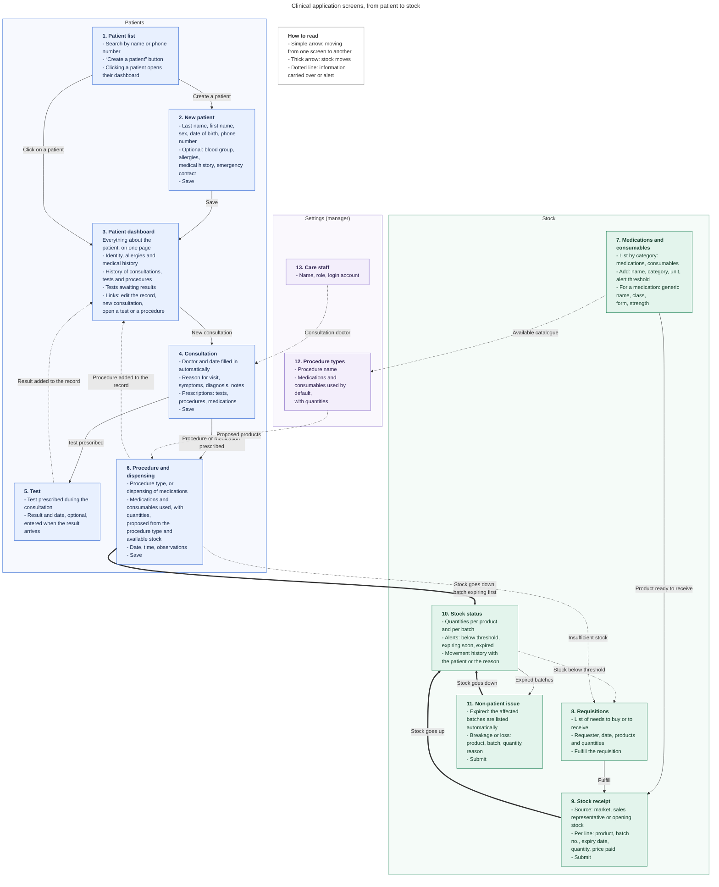

| Status           | Proposed                                                                                                                                                                                                        |
| ---------------- | --------------------------------------------------------------------------------------------------------------------------------------------------------------------------------------------------------------- |
| Date             | 2026-11-04                                                                                                                                                                                                      |
| Deciders         | Platform Engineering                                                                                                                                                                                            |
| Affected systems | Every client site where Sky-healthcare is installed                                                                                                                                                             |
| Related          | [ADR-003](https://docs.int.skyengpro.app/bin/view/Architecture/ADR-ERPNext/ADR-003) (permissions as code), [ADR-004](https://docs.int.skyengpro.app/bin/view/Architecture/ADR-ERPNext/ADR-004) (tenant isolation) |

## Context

### Clinics on the ERP platform

Health facilities, such as clinics and small health centers, share a set of everyday needs. These include patient management (registration, consultations, prescribed tests and medicines, the patient record) and the management of drugs and medical consumables in stock (batches, expiry dates, requisitions, consumption by care).

The Frappe ecosystem already covers both areas. `frappe/healthcare`, which depends on ERPNext, manages patients and care. ERPNext Stock manages items, batches and expiry dates. Both are maintained upstream.

Their interface is designed for a full hospital information system. It shows far more than a clinic uses, and its routine tasks are spread over several documents and modules. With the current upstream version, recording a procedure and the products it consumes takes three documents and about eight actions, for what staff see as a single operation. These flows may change with future upstream versions. Some of them also depend on site settings that a new site does not have, such as batch tracking or picking batches by expiry date.

### Decision criteria

The options below are compared on four points:

* The application is the same on every client site.
* Patient and stock logic stays upstream and keeps receiving its fixes.
* Records are standard documents that standard reports can read and that later needs, such as billing or inpatient care, can reuse.
* A routine task fits on one screen for staff who are not ERP users.

## Decision

1. **Sky-healthcare is a Frappe app that puts a simplified interface on top of Healthcare and ERPNext.** It is installed on the same site, depends on both, and does not change their code.

3. **Clinic staff work in the app's own interface, and Desk stays with administrators.** The interface covers only the common base: patients, consultations, tests, care and dispensing, and the stock of drugs and consumables. Features it leaves out stay available in Desk and can be added to the interface later.
4. **The app has no data model of its own for patients or stock.** Each screen reads and writes standard Healthcare and ERPNext documents, so their validations, permissions and stock rules apply as they are.
5. **The interface reaches the backend only through what the platform already exposes.** Nothing writes to the database directly. Server-side code is added only where the existing interfaces cannot serve a screen, and each addition is justified on its own.

> [medication-flows-clinical-interface.md](medication-flows-clinical-interface)

5. **Roles and essential settings are shipped with the app.** The roles staff need on the underlying documents, and the site settings the flows depend on, are set by the app at installation instead of by hand on each site. A configuration document kept with the app lists everything the installation sets.

## Options considered

On the approach:

* **Chosen: a simplified interface over Healthcare and ERPNext.** Keeps the existing patient and stock logic without changing it. Every record is a standard document, visible in Desk and in standard reports, and the app installs and updates through Press like the platform's other apps. The cost is one interface to build and maintain, and a dependency on how upstream documents and flows are shaped.
* **Rejected: a standalone application outside the Frappe ecosystem.** Gives full control over the data model and the interface, at the price of rebuilding the patient record, batch and expiry tracking, stock valuation and permissions that Healthcare and ERPNext already provide and test. It would not deploy through Press, and each later need, such as billing or inpatient care, would have to be built as well.
* **Rejected: Healthcare and ERPNext in Desk, configured and customized.** The cheapest option to deliver. A dedicated workspace, form customization and client scripts can hide unused modules and shorten forms. Desk still shows one form per document, so a task that spans three documents still spans three forms, and staff still need to know settings the forms do not show.
* **Rejected: a fork of Healthcare with simplified forms.** Reaches the same result as the chosen option, with the added cost of merging every upstream fix by hand. The simplification would also live in forms that upstream keeps changing.

On roles and settings:

* **Chosen: shipped with the app.** Every site gets the same roles and settings, reproduced at each installation and documented in one place.
* **Rejected: configured by hand on each site.** Each installation would depend on someone repeating the same steps correctly, and sites would drift apart over time.

Deferred:

* **Deferred: billing, accounting, and inpatient care in the interface.** They are outside the common base. Records are already standard documents, so these can be added to the interface later without hard effort.

## Consequences

### Positive

* Clinic staff get one screen per routine task, limited to the features the common base needs. Client sites without the app are unaffected.
* Patient and stock logic, including batches, expiry and the stock ledger, comes from Healthcare and ERPNext and receives their fixes. Desk, standard reports and later work all start from the same records.
* Roles and settings are identical on every site and reproduced at each installation, with one document that lists them.

### Negative

* The interface depends on upstream structure and behaviour. It relies on document fields, methods and flows that Healthcare and ERPNext can change between versions, so each upgrade is tested against every flow before it reaches a client site.
* Staff roles must cover every document the interface writes, including documents staff never open directly.
* One user action can span several documents. A failure partway through leaves a partial state, which the interface has to detect and let the user complete.
* Settings shipped with the app apply to the whole site. Picking batches by expiry date, for example, applies to all stock on the site, clinic products or not. A client that keeps other stock on the same site inherits these settings, and the configuration document makes them visible before installation.
* The site carries all of Healthcare and ERPNext, including the modules the clinic does not use and the settings they require.
* Patient records are more sensitive than the business data the platform hosts so far, and they inherit its isolation limits ([ADR-004](https://docs.int.skyengpro.app/bin/view/Architecture/ADR-ERPNext/ADR-004)). Any code execution in a bench container reaches every site on that bench, which now includes medical records. The same holds for any app on the platform that stores sensitive data.

## Implementation

| Order | Implementation                                                                          | Ticket                                                        |
| ----- | --------------------------------------------------------------------------------------- | ------------------------------------------------------------- |
| 1     | App skeleton, roles and essential settings shipped with the app, configuration document | [SH-01](https://github.com/skyengpro/sky-healthcare/issues/10) |
| 2     | Patient management screens                                                              | [SH-02](https://github.com/skyengpro/sky-healthcare/issues/11) |
| 3     | Stock management screens                                                                | SH-03                                                         |
| 4     | Integration tests for each flow, run before every upstream upgrade                      | SH-04                                                         |
