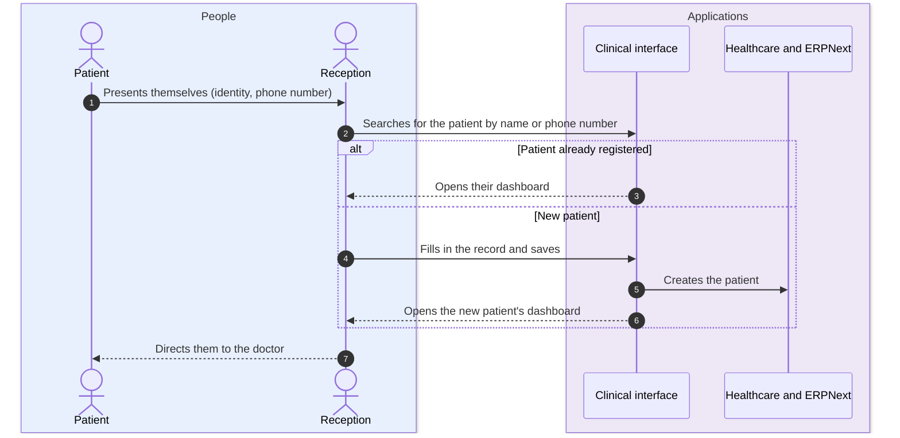
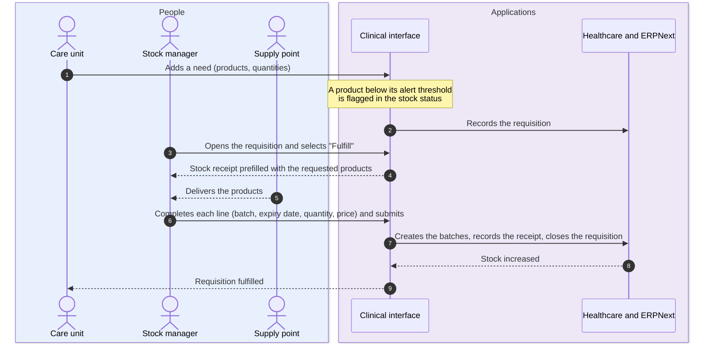
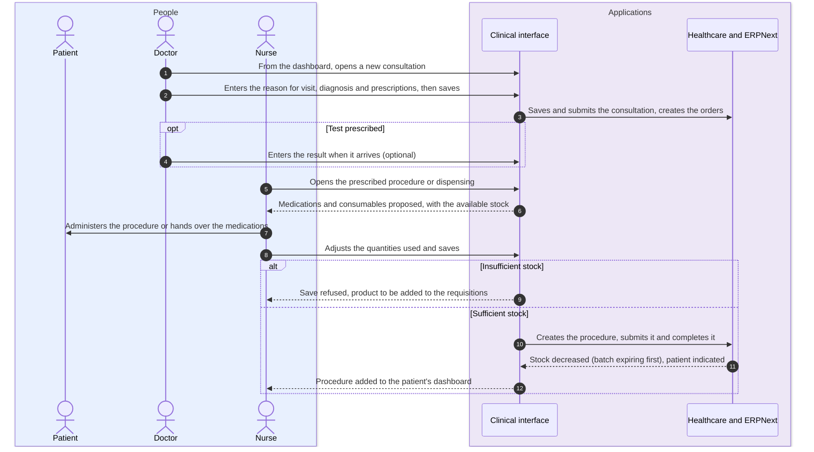
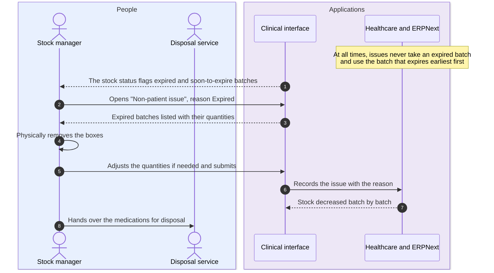

# Medication flows with the clinical interface

People in blue, applications in purple or green. Solid arrows: actions. Dotted arrows: responses or results.

## 1. Register a patient

## 2. Requisition and stock receipt

A delivery without a requisition goes directly through the "Stock receipt" screen, with the same fields.

## 3. Consultation, procedure and dispensing

## 4. Remove expired medications

