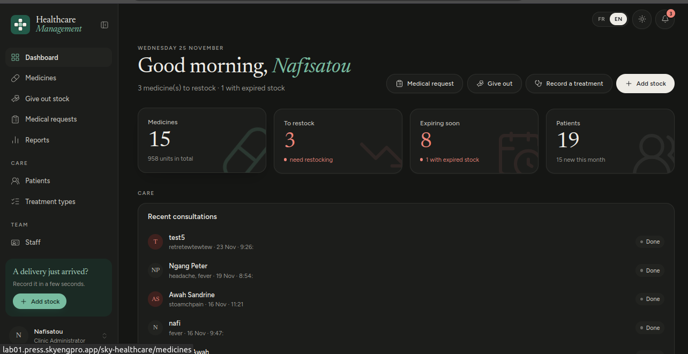
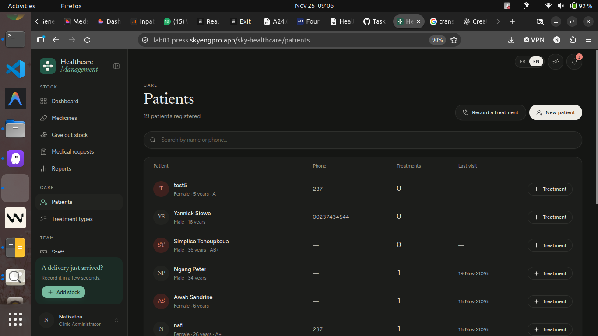
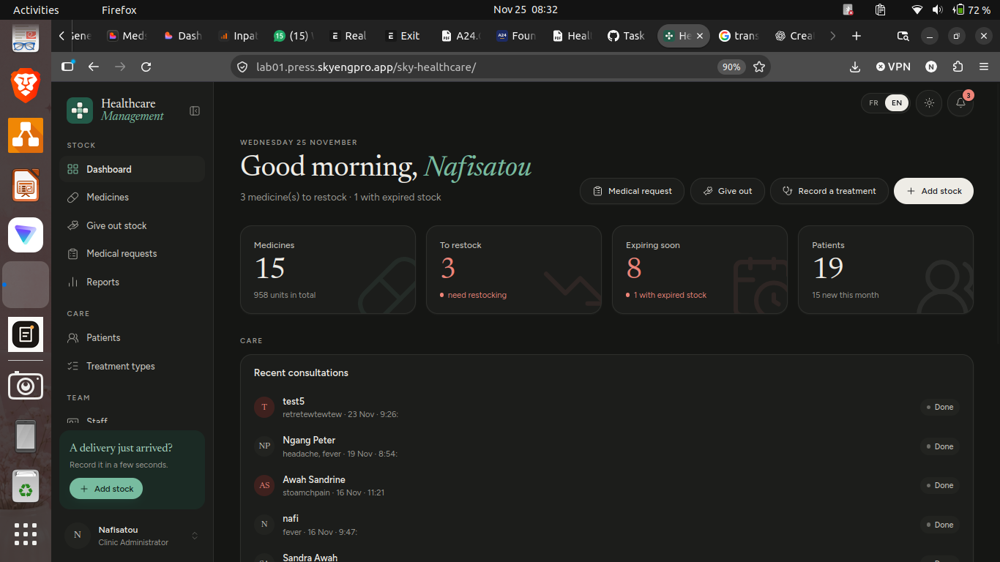
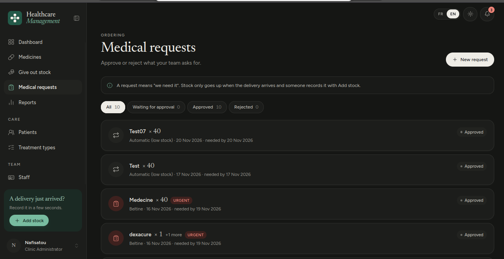
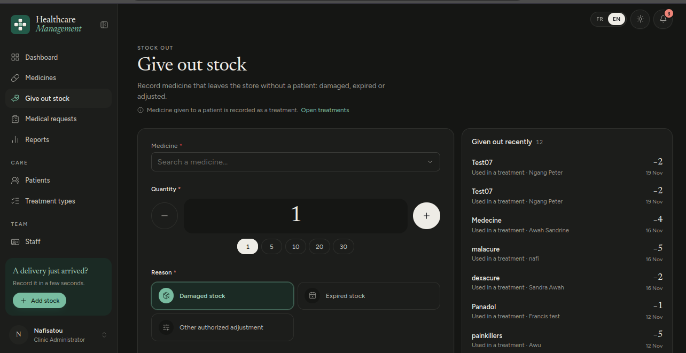
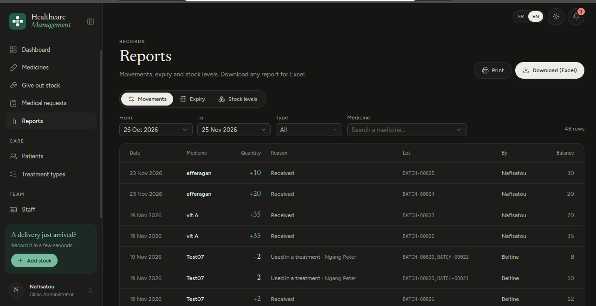
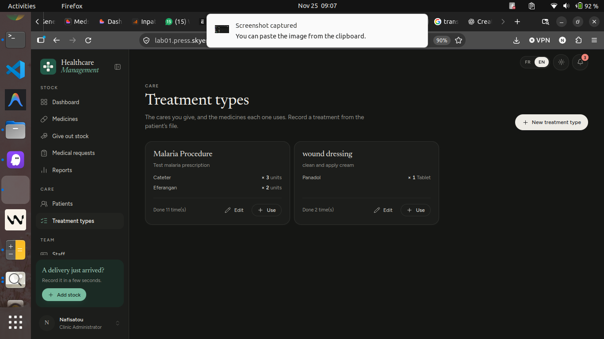

# Sky Healthcare — User Guide

---

## Table of contents

1. [What is Sky Healthcare?](#1-what-is-sky-healthcare)
2. [Who uses it and what roles exist](#2-who-uses-it-and-what-roles-exist)
3. [Getting around the interface](#3-getting-around-the-interface)
4. [Dashboard (Overview)](#4-dashboard-overview)
5. [Patient management](#5-patient-management)
   - 5.1 [Search for a patient](#51-search-for-a-patient)
   - 5.2 [Register a new patient](#52-register-a-new-patient)
   - 5.3 [Record a treatment](#53-record-a-treatment)
6. [Stock management](#6-stock-management)
   - 6.1 [Medicines catalogue](#61-medicines-catalogue)
   - 6.2 [Medical requests (requisitions)](#62-medical-requests-requisitions)
   - 6.3 [Give out stock](#63-give-out-stock)
   - 6.4 [Reports](#64-reports)
7. [Settings (managers only)](#7-settings-managers-only)
   - 7.1 [Treatment types](#71-treatment-types)
   - 7.2 [Staff](#72-staff)
8. [Complete workflow examples](#8-complete-workflow-examples)
9. [Frequently asked questions](#9-frequently-asked-questions)

---

## 1. What is Sky Healthcare?

Sky Healthcare is a clinical interface for small health facilities — clinics and health centres. It sits on top of Frappe Healthcare and ERPNext, so all patient records and stock movements are stored in those systems. The interface itself hides the complexity: each routine task fits on one screen.

Key things to know:

- Every record you create here (patient, treatment, stock receipt) is a standard document visible to administrators in Frappe Desk and in standard reports.
- Stock always moves out of the batch that expires first (FEFO — first expiry, first out). You cannot dispense from an expired batch.
- Saving a treatment automatically reduces the stock. If stock is insufficient, the save is refused and the system suggests creating a medical request.

---

## 2. Who uses it and what roles exist

| Role | Main tasks |
|------|-----------|
| **Reception** | Search for and register patients |
| **Doctor / Nurse** | Record treatments, dispense medicines |
| **Stock manager** | Add stock, approve medical requests, give out damaged or expired stock |
| **Administrator** | Configure treatment types, manage staff accounts |

---

## 3. Getting around the interface

The left sidebar has two sections:

**Stock**
- Dashboard
- Medicines
- Give out stock
- Medical requests
- Reports

**Care**
- Patients
- Treatment types

**Team**
- Staff

---

## 4. Dashboard (Overview)

The dashboard is the first screen you see after logging in. It gives an instant overview of the facility's status.

What you see:

| Card | What it means |
|------|--------------|
| **Medicines** | Total number of medicine types in the catalogue and total units in stock |
| **To restock** | Medicines below their alert threshold — needs a medical request |
| **Expiring soon** | Batches expiring within the alert window, with a note if any are already expired |
| **Patients** | Total registered patients and how many are new this month |

Below the cards, **Recent consultations** lists the latest treatments recorded, with the patient name, reason, date and status.

The quick-action buttons at the top right let you jump directly to: **Medical request**, **Give out**, **Record a treatment**, or **Add stock**.

---

## 5. Patient management

### 5.1 Search for a patient

1. Go to **Care → Patients**.
2. Type the patient's name or phone number in the search bar.
3. Click the patient's row to open their record.

The list shows each patient's name, sex, age, blood group, phone number, number of treatments, and last visit date. Click **+ Treatment** on any row to record a treatment directly.

> If no results appear the patient has not been registered yet — click **New patient**.

---

### 5.2 Register a new patient

1. Go to **Care → Patients** and click **New patient**.
2. Fill in: last name, first name, sex, date of birth, phone number.
3. Add optional fields as available: blood group, allergies, medical history, emergency contact.
4. Click **Save**.

The patient's record opens immediately after saving.

---

### 5.3 Record a treatment

1. From the Patients list, click **+ Treatment** next to the patient, or open the patient and click **Record a treatment**.
2. Select the treatment type — the medicines and consumables used by default are pre-filled from the treatment type.
3. Adjust quantities if needed.
4. Add the date, time, and any observations.
5. Click **Save**.

**If stock is sufficient:** the treatment is saved and stock decreases automatically, batch by batch (oldest expiry first).

**If stock is insufficient:** the save is refused. Create a medical request for the missing medicine (see [6.2](#62-medical-requests-requisitions)) and retry once stock has been received.

---

## 6. Stock management

### 6.1 Medicines catalogue

The catalogue is the master list of all medicines and consumables the facility uses.

**Filter tabs at the top:** All · Low stock · Out of stock · Expiring soon · Expired · In stock

**Columns:** Medicine name, category and form · Units in stock (with a visual bar) · Nearest expiry date · Location (shelf) · Status badge

**To add a medicine:**
1. Click **New medicine**.
2. Fill in: name, category, unit, alert threshold, generic name, therapeutic class, form, strength.
3. Click **Save**.

**To add stock for an existing medicine:**
Click **+ Stock** on the medicine row, or use the **Add stock** button in the top right. Fill in: batch number, expiry date, quantity, price paid, then submit.

---

### 6.2 Medical requests (requisitions)

A medical request records a need — medicines and quantities to order from the supply point.

**Status tabs:** All · Waiting for approval · Approved · Rejected

Requests marked **Urgent** are highlighted in orange. Automatic requests are created by the system when a medicine falls below its alert threshold.

**To create a request:**
1. Click **+ New request**.
2. Enter the medicine, quantity needed, and required date.
3. Click **Save**.

The request stays in **Waiting for approval** until a manager approves it. Stock only goes up when the delivery arrives and someone records it with **Add stock** — approving a request does not add stock.

---

### 6.3 Give out stock

Use this screen to remove medicines from stock for reasons other than a patient treatment: damaged stock, expired stock, or other authorised adjustments.

1. Go to **Stock → Give out stock**.
2. Search for the medicine.
3. Set the quantity using the number buttons (1 · 5 · 10 · 20 · 30) or the +/− controls.
4. Select the reason:
   - **Damaged stock**
   - **Expired stock** — expired batches are listed automatically
   - **Other authorised adjustment**
5. Click **Submit**.

The right panel shows the 12 most recent give-outs for reference.

> Medicine given to a patient is recorded as a treatment, not here. Use the **Open treatments** link if you need to correct a patient dispensing.

---

### 6.4 Reports

The Reports screen covers all stock movements, expiry tracking, and stock levels. Any report can be downloaded as an Excel file.

**Three report tabs:**

| Tab | What it shows |
|-----|--------------|
| **Movements** | Every stock change — received, used in a treatment, given out — with date, medicine, quantity, reason, batch, operator and running balance |
| **Expiry** | All batches sorted by expiry date, to spot what expires soon |
| **Stock levels** | Current quantity per medicine and per batch |

**To filter Movements:**
- Set a **From** and **To** date.
- Choose a **Type** (All, Received, Treatment, Give-out).
- Search by **Medicine** name.

Click **Print** for a printable view or **Download (Excel)** to export.

---

## 7. Settings (managers only)

### 7.1 Treatment types

Treatment types define the default medicines and consumables used in a given procedure, with their default quantities. When a nurse records a treatment, these defaults are pre-filled, saving time and reducing errors.

Each card shows the treatment name, description, the medicines it uses with quantities, and how many times it has been used.

**To add a treatment type:**
1. Click **+ New treatment type**.
2. Enter the name and description.
3. Add each medicine or consumable with its default quantity.
4. Click **Save**.

**To use a treatment type directly** from this screen, click **Use** on the card — it opens a new treatment pre-filled with that type.

---

### 7.2 Staff

Staff records link a person's name and role to their login account.

Each card shows the staff member's name, email, role (Administrator or Staff), and when they last logged in.

**To add a staff member:**
1. Click **+ Add a person**.
2. Enter: name, email, and role.
3. Click **Save**.

The person receives login credentials and can access the app according to their role.

---

## 8. Complete workflow examples

### Walk-in patient receiving treatment

1. Reception searches for the patient in **Patients**. Not found — clicks **New patient**, fills in name, sex, date of birth and phone number, saves.
2. The doctor clicks **+ Treatment** on the patient row, selects the treatment type (e.g. Malaria Procedure), confirms quantities, and saves.
3. Stock decreases automatically (oldest expiry batch first). The treatment appears in the patient's history.

---

### Low-stock replenishment

1. The dashboard shows **3 to restock**. The stock manager opens **Medical requests**, sees the automatic low-stock requests, and approves them.
2. The supply point delivers. The stock manager goes to **Medicines**, finds the medicine, clicks **+ Stock**, enters batch number, expiry date, quantity and price, then submits.
3. The dashboard restock count drops. The medicine's status changes from **Low stock** to **In stock**.

---

### Removing damaged or expired stock

1. The stock manager goes to **Give out stock**.
2. Selects the medicine, sets the quantity, chooses **Damaged stock** or **Expired stock**.
3. Submits. Stock decreases and the movement is recorded in Reports with the reason.

---

## 9. Frequently asked questions

**Can I undo a submitted stock movement?**
Submissions are reversible by an administrator in Frappe Desk. Contact your site administrator.

**What happens if I try to record a treatment with insufficient stock?**
The save is refused with a message indicating which medicine is short. Create a medical request, wait for the stock to be received, then retry the treatment.

**Why does the system pick a specific batch instead of letting me choose?**
The system always uses the batch that expires first (FEFO). This minimises waste and prevents expired medicines from being given to patients.

**A medicine shows as expired in the system but the box says it is not. What do I do?**
Check the expiry date entered when the stock was received. If it was entered incorrectly, an administrator can correct it in Frappe Desk before the batch is used.

**Approving a medical request did not increase the stock. Is that normal?**
Yes. A request is an order, not a receipt. Stock only goes up when the delivery physically arrives and someone records it with **Add stock** in the Medicines screen.

**Who can access Frappe Desk?**
Only administrators. All routine tasks for clinic staff are available within the Sky Healthcare interface.

---

*Sky Healthcare is built and maintained by [SkyEngPro](https://skyengpro.com). For support, contact contact@skyengpro.com.*
